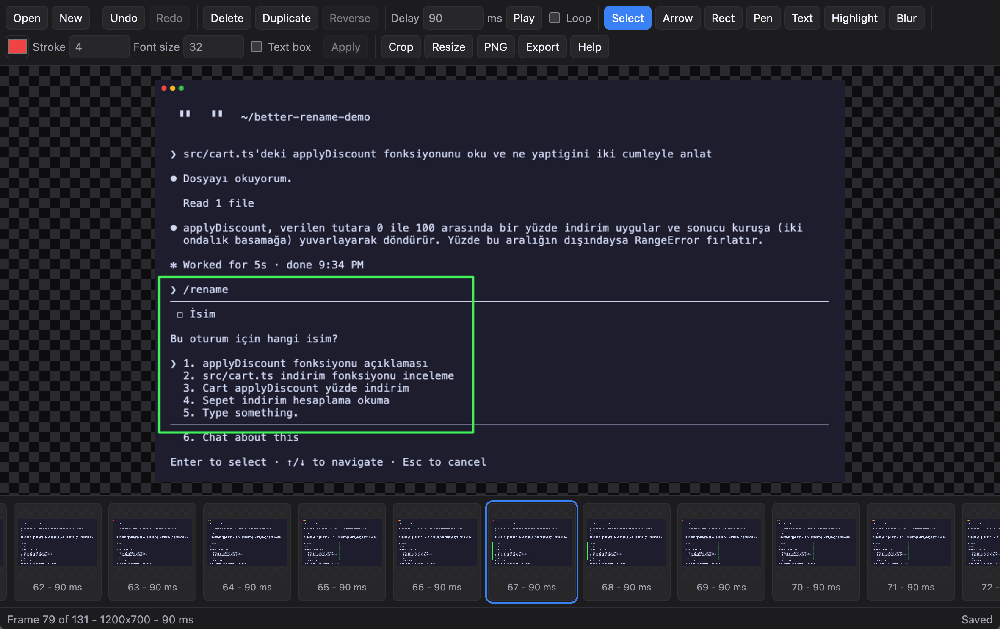

# GIF Editor

A browser GIF editor. Open a GIF, reorder and time the frames, draw on them, then download a new GIF or a PNG of the current frame. Decoding, editing, and export all run in the browser. The file is never uploaded.

I made this for a simple job on Mac screen-recording GIFs: cut and duplicate frames, add shapes and text, and export a file that stays small. This version does that for me. If you have the same kind of work, build on it instead of starting from scratch.

[Demo](https://trkaplan.github.io/gif-editor-online/)



## Run locally

```sh
pnpm install
pnpm dev
```

Open the URL Vite prints. `pnpm test` checks the decoder, frame edits, and exporter. `pnpm build` writes the static site to `dist/`.

## Deploy

Push to `main`. GitHub Actions runs the tests, builds the site, and deploys it to GitHub Pages. In the repository settings, set Pages to **GitHub Actions**.

The build uses relative paths, so it works at `https://<user>.github.io/<repo>/`.
